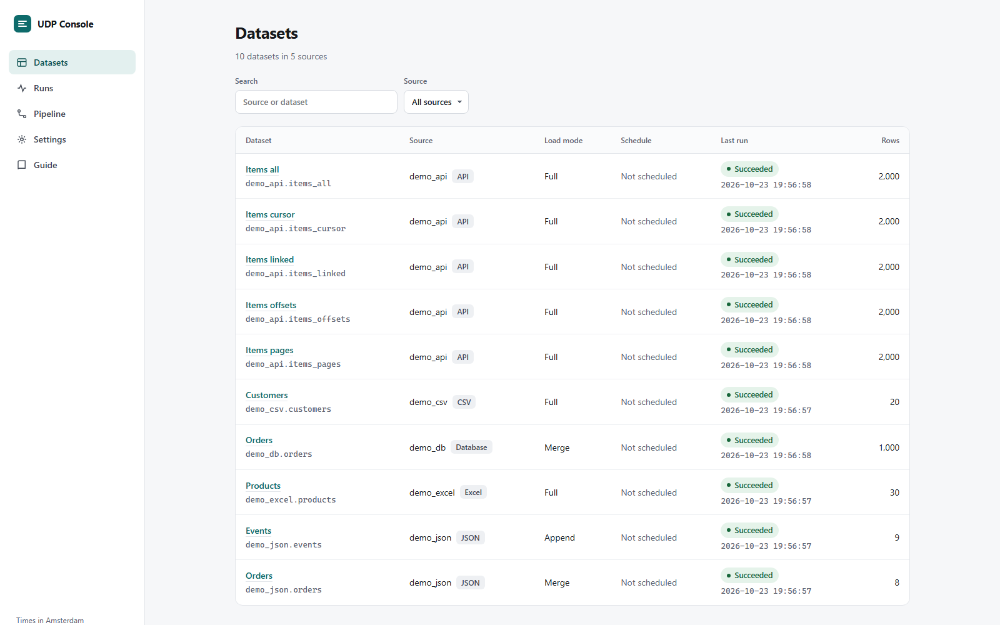

# universal-data-pipeline

A data platform that loads CSV files, Excel workbooks, JSON files, database tables and REST APIs
into PostgreSQL, checks the data, and shows it in a dashboard. Each source is one small YAML file.

## Start it

You need Docker with Compose. On Windows or macOS, start Docker Desktop first and wait until it
says the engine is running. Then install the `udp` command. It goes in a `udp` folder in your home
folder (`~/udp`, on Windows `%USERPROFILE%\udp`), which holds everything the platform reads.

On Windows, in PowerShell:

```
irm https://raw.githubusercontent.com/williammgb/universal-data-pipeline/main/deploy/install.ps1 | iex
```

On macOS or Linux:

```
curl -fsSL https://raw.githubusercontent.com/williammgb/universal-data-pipeline/main/deploy/install.sh | sh
```

Then, in a new terminal:

```
udp up
```

The first `udp up` saves a new database password and API key in `~/udp/.env` and prints the key.
Open http://127.0.0.1:8000 (or run `udp open`) and enter that key. This runs the `latest`
release; to pin one, add the line `UDP_VERSION=2.0.0` to `~/udp/.env`.

| Command | What it does |
| --- | --- |
| `udp up` (or `udp run`) | start the platform and print its address |
| `udp down` | stop it, keeping the data |
| `udp status` | show the containers |
| `udp logs [service]` | the last 100 log lines (add `-f` to follow them) |
| `udp open` | open the dashboard in the browser |
| `udp restart` | restart the API and the scheduler (after adding a schedule) |
| `udp upgrade` | pull the newest images and start on them |
| `udp backup` | save the database to `~/udp/backups/udp-<date>-<time>.dump` |
| `udp new <source>` | write `sources/<source>/source.yaml` from that folder's files |
| `udp help` | this list |
| `udp <command> ...` | anything else runs in the app: `load`, `pipeline`, `profile`, `doctor` |

## Add a source

A source is a folder in `~/udp/sources/`. Put your data files in it, directly or in its `data/`
folder:

```
~/udp/sources/
  my_shop/
    data/customers.csv
```

Then describe it and load it:

```
udp new my_shop
udp load my_shop
```

`udp new` writes `sources/my_shop/source.yaml`, with one dataset per file, and `udp load` loads
them. The dataset now shows in the dashboard. Excel, JSON, database and REST API sources, quality
checks and schedules are settings in that file, all in
[docs/adding-a-source.md](docs/adding-a-source.md).

## Coming from the old commands

If you started the platform before with `export POSTGRES_PASSWORD=...` and a `docker compose`
line:

- Before the first `udp up`, set `POSTGRES_PASSWORD` and `UDP_API_KEYS` to the values you used
  then (`export NAME=value`, or `$env:NAME = 'value'` in PowerShell). `udp up` saves them in
  `~/udp/.env`, and the data you loaded is there again. Or write that file yourself, with both
  lines: `POSTGRES_PASSWORD='your-password'` and `UDP_API_KEYS='your-key'`.
- Copy your old `sources/` folders into `~/udp/sources/`.

To uninstall, run `udp down`, delete the `~/udp` folder, and take it off your PATH: on macOS or
Linux, delete the line ending in `# udp` from `~/.bashrc`, `~/.zshrc` or `~/.profile`; on Windows,
remove `%USERPROFILE%\udp` from the user PATH (Settings > Environment variables).

## More

[docs/guide.md](docs/guide.md) covers running from the source code, the demo, cleaning data with
pipelines, settings, and backups. The dashboard's **Guide** tab explains each page.


